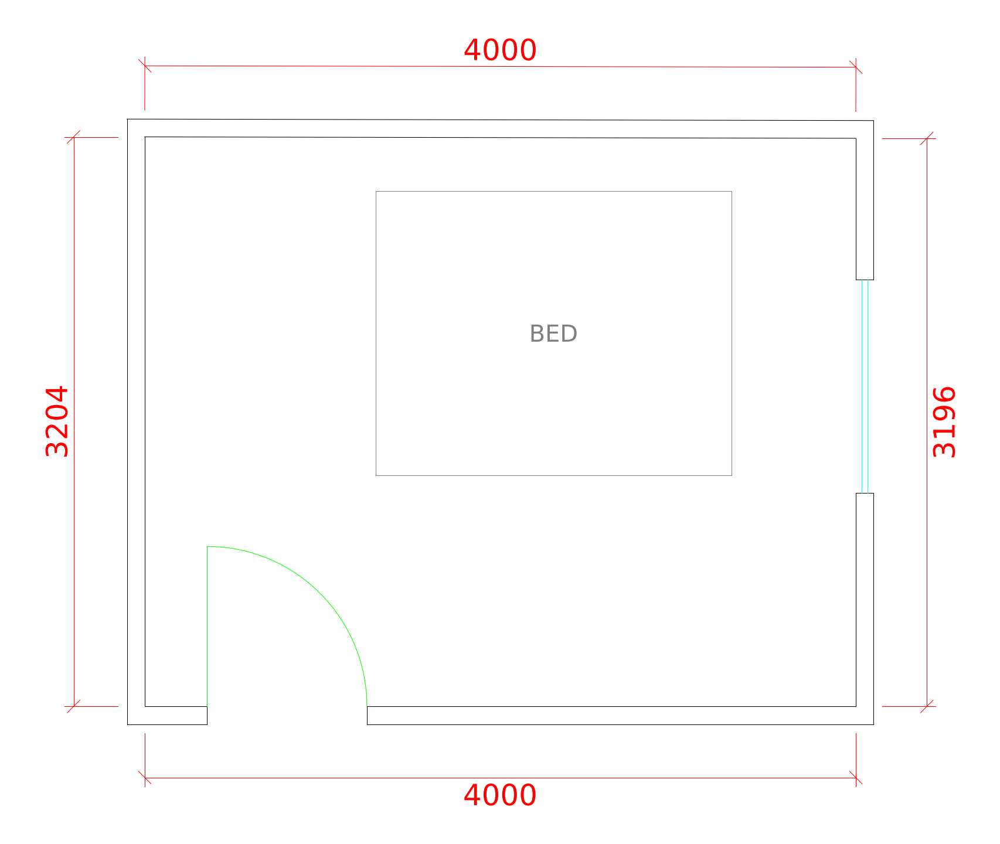

# MeasurePlan

An iPhone app that scans a room with the camera and LiDAR (Apple RoomPlan), draws its 2D floor plan, and exports a **DXF** file that opens directly in AutoCAD.



[`samples/sample-room.dxf`](samples/sample-room.dxf) is an example of the output. Open it in AutoCAD, DWG TrueView or LibreCAD.

## What it does

1. **Scan Room**: RoomPlan guides you around the room and detects walls, doors, windows, openings and furniture.
2. **Plan**: walls are joined at the corners and drawn with thickness, with door swings, window glazing, furniture outlines and interior dimensions.
3. **Export DXF**: the share sheet sends the file to Files, Mail, AirDrop, Google Drive and so on.

On devices without LiDAR (and in the simulator) you can use **Add Sample Room** from the toolbar menu to try the plan view and export.

## DXF output

- Format: ASCII DXF R12 (AC1009), the most widely readable version.
- Units: drawn 1:1 in **millimetres** by default, or inches when "ft-in" is selected.
- Layers: `A-WALL`, `A-DOOR`, `A-GLAZ`, `A-FURN`, `A-DIMS`, `A-ANNO`.
- Dimensions are the interior (clear) length of each wall. Wall thickness is a 100 mm default, because a scan from inside one room can't see how thick a wall is.

To get a DWG, open the DXF in AutoCAD and use Save As.

## Requirements

- Mac with Xcode 15 or newer
- iPhone or iPad with LiDAR (iPhone 12 Pro or newer Pro models, iPad Pro 2020 or newer) running iOS 17+
- Apple Developer account to install on a device via TestFlight

## Build and run

```sh
brew install xcodegen
xcodegen                 # creates MeasurePlan.xcodeproj from project.yml
open MeasurePlan.xcodeproj
```

In Xcode, pick your team under Signing & Capabilities, change the bundle identifier from `com.example.measureplan` to your own, connect your iPhone, and press Run.

## Run on an iPad without a Mac (Swift Playgrounds)

```sh
./tools/make-playground.sh   # writes build/MeasurePlan.swiftpm.zip
```

Copy the zip to the iPad, unzip it in the Files app, and open `MeasurePlan.swiftpm` in Swift Playgrounds. Then press Run. To install it as a standalone app, use the app settings menu. Room scanning needs an iPad Pro with LiDAR. On other iPads, use "Add Sample Room".

## Tests

The geometry and DXF code lives in a separate Swift package that runs without a device:

```sh
cd Packages/PlanCore
swift test
```

## Project layout

```
MeasurePlan/                 iOS app (SwiftUI)
  ScanView.swift             RoomPlan capture screen
  RoomPlanConverter.swift    RoomPlan 3D result -> top-view items
  PlanDetailView.swift       Plan preview, units, DXF export
  PlanPreviewView.swift      On-screen drawing of the plan
  ScanStore.swift            Saved scans (JSON in Documents/Scans)
Packages/PlanCore/           Platform-independent core
  PlanBuilder.swift          Joins wall corners, attaches doors/windows to walls
  PlanDrawing.swift          Plan -> layered lines, arcs and text
  DXFWriter.swift            Layered line work -> DXF
samples/                     Example output
```

`PlanCore` doesn't depend on RoomPlan, so a tap-the-corners capture mode or an Android port can reuse it later.

## Roadmap

Next up: multi-room scans, editing wall lengths by hand, PDF export, and DWG export.
