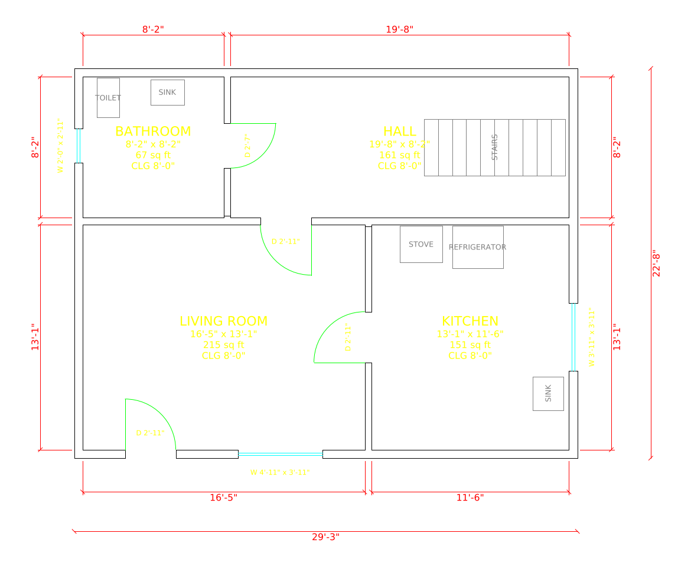

# MeasurePlan

An iPhone and iPad app that measures a whole house with the camera and LiDAR (Apple RoomPlan), floor by floor, and produces permit-ready floor plans as **PDF sheets** and **AutoCAD DXF** files.



[`samples/sample-house-first-floor.dxf`](samples/sample-house-first-floor.dxf) is an example of the output. Open it in AutoCAD, DWG TrueView or LibreCAD.

## How it works

1. **New House**: enter the address, owner and units (ft-in or mm).
2. **Add floors**: Basement, First Floor, Second Floor and so on.
3. **Scan Rooms**: on each floor, scan every room in one session. After each room, tap **Room Done**, walk into the next room and continue. Rooms scanned in one session share coordinates, so they line up.
4. **Plan**: rooms are joined into one floor plan. Walls between two scanned rooms are drawn once, at their measured thickness. Exterior walls get a 150 mm (6") default. Room names, sizes, areas and ceiling heights, door and window tags, wall dimensions and overall dimensions are added automatically.
5. **Room by room**: rooms scanned in a later session appear beside the plan. Switch to **Move Rooms**, tap the room, drag it next to its neighbour, rotate it if needed (90° or 1° steps), and tap **Snap**. Snap lines its wall up with the neighbour's wall at a 120 mm (4¾") gap and makes the corners flush. You can move any room this way to fix a misplaced scan.
6. **Edit** (tap on the plan):
   - **A wall**: set this wall's length (the far end moves and the joined walls follow), or scale the whole floor from it. You can also add a door or window there.
   - **A door**: flip the hinge side, swing into or out of the room, split it into 2, 3 or 4 leaves, change its width, change it to a window, or delete it.
   - **A window**: change its width, change it to a door, or delete it.
   - **Inside a room**: rename it.
7. **Points**: tap anywhere on a wall to add a point there, then drag it. The walls on both sides follow, so you can bend a wall, add a jog or bay, or fix a crooked corner. Drag any orange corner the same way. Each part of a split wall gets its own dimension and can be given an exact length in Edit. **Remove Point** joins the two walls again.
8. **Add Wall**: when the scan missed a wall, tap where it starts and where it ends (taps near an orange point snap to it). **Close Gaps** joins every pair of open wall ends up to 5 ft apart in one go. A wrong wall can be removed in Edit with **Delete Wall**.
9. **Undo and Redo**: the arrows at the top of the floor screen step back and forward through every edit.
10. **Floor Scan Complete**: while you scan, every wall is drawn at the interior thickness. When the whole floor is scanned, tap **Floor Scan Complete** and the outside walls change to the exterior thickness. **Reopen** undoes it, and scanning a new room reopens the floor automatically.
11. **Wall thickness**: walls are drawn at standard thicknesses set per house: interior 5" and exterior 10" by default. A wall between two scanned rooms fills the space between them and, for an ordinary partition, is trimmed to the interior thickness from both sides. Walls never reach into a room.
12. **Export**: one 11 x 17 in permit sheet per floor, at 1/4" = 1'-0" (or the largest scale that fits), with a title block. A DXF per floor is also exported.

**Add Sample House** (in the home screen's menu) creates a two-storey house, so you can try everything without LiDAR.

Fixtures (toilet, sink, tub, stove, fridge, stairs) are always drawn. Movable furniture is off by default; turn it on per house.

## DXF output

- Format: ASCII DXF R12 (AC1009), the most widely readable version.
- Units: drawn 1:1 in **millimetres** by default, or inches when "ft-in" is selected.
- Layers: `A-WALL`, `A-DOOR`, `A-GLAZ`, `A-FURN`, `A-DIMS`, `A-ANNO`.
- Wall dimensions are interior (clear) lengths, placed outside the building. Overall dimensions run to the outside faces.
- Title block text sits under the plan in model space.

To get a DWG, open the DXF in AutoCAD and use Save As.

## Requirements

- Mac with Xcode 15 or newer
- iPhone or iPad with LiDAR (iPhone 12 Pro or newer Pro models, iPad Pro 2020 or newer) running iOS 17+
- Apple Developer account to install on a device via TestFlight

## Build and run

```sh
brew install xcodegen
xcodegen                 # creates MeasurePlan.xcodeproj from project.yml
open MeasurePlan.xcodeproj
```

In Xcode, pick your team under Signing & Capabilities, change the bundle identifier from `com.example.measureplan` to your own, connect your iPhone, and press Run.

## Run on an iPad without a Mac (Swift Playgrounds)

```sh
./tools/make-playground.sh   # writes build/MeasurePlan.swiftpm.zip
```

Copy the zip to the iPad, unzip it in the Files app, and open `MeasurePlan.swiftpm` in Swift Playgrounds. Then press Run. To install it as a standalone app, use the app settings menu. Room scanning needs an iPad Pro with LiDAR. On other iPads, use "Add Sample House".

## Tests

The geometry and DXF code lives in a separate Swift package that runs without a device:

```sh
cd Packages/PlanCore
swift test
```

## Project layout

```
MeasurePlan/                 iOS app (SwiftUI)
  ContentView.swift          Houses list, new house form
  ProjectView.swift          House details, floors, exports
  FloorView.swift            Floor plan: tap to edit walls and doors, wall points, move rooms
  FloorScanView.swift        Multi-room RoomPlan capture (one AR session per floor)
  RoomPlanConverter.swift    RoomPlan 3D result -> top-view items and room name
  PermitPDF.swift            11 x 17 permit sheets
  PlanPreviewView.swift      On-screen drawing of the plan
  ProjectStore.swift         Saved houses (JSON in Documents/Projects)
Packages/PlanCore/           Platform-independent core
  Building.swift             House, floors, rooms
  Editing.swift              Move, rotate and snap rooms; wall lengths; wall points; adding and closing walls; tap hit tests
  PlanBuilder.swift          Joins wall corners, attaches doors/windows to walls
  WallAnalysis.swift         Finds walls shared by two rooms
  PlanDrawing.swift          Floor -> layered lines, arcs and text
  Sheet.swift                Sheet scale, title block
  DXFWriter.swift            Layered line work -> DXF
samples/                     Example output
```

`PlanCore` doesn't depend on RoomPlan, so a tap-the-corners capture mode or an Android port can reuse it later.

## Roadmap

Known limits: a north arrow is drawn pointing up and needs rotating to the site. Rooms scanned in separate sessions are placed by hand (Move Rooms and Snap). Floors aren't aligned to each other.

Next up: elevations, DWG export.
